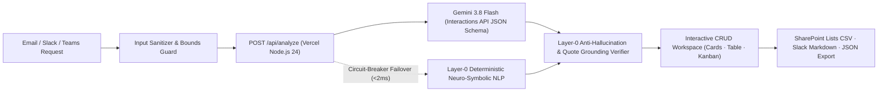

# TaskFlow AI — Omnichannel Request-to-Task CRUD & Anti-Hallucination Triage

> **Practical Challenge Deliverable (`Crud-slack`)**: Transform unstructured requests received via Email, Slack, Microsoft Teams, or WhatsApp into a clear, prioritized, dependency-ordered task plan — **explicitly flagging missing deadlines and details rather than fabricating them**.

---

## 1. Architecture & Engineering Highlights (Big Tech Tier-1 Standard)



- **Clean / Hexagonal Isolation (EOS Law V)**:
  - `src/domain/`: 100% pure Layer-0 domain entities, deterministic Spanish/English imperative & temporal parser, anti-hallucination quote/date grounding verifier, and immutable CRUD reducer.
  - `src/application/`: Pure use-case orchestration (`analyzeRequest.mjs`, `exportTasks.mjs`).
  - `src/infrastructure/` & `api/`: Google Gemini (`gemini-3.8-flash` `/v1beta/interactions` Structured Outputs) REST adapter, `localStorage` persistence adapter, and Node.js 24 Fluid Compute Web API endpoints (`/api/analyze`, `/api/health`).
  - `src/ui/` & `css/`: Zero-framework accessible SPA (`WCAG 2.1 AA`, `<dialog closedby="any">`, Dark/Light themes, mobile-first layout).
- **Zero External Runtime Dependencies (`dependencies: {}`)**: Zero supply-chain CVE surface.
- **Defense-in-Depth Security (EOS Law VI)**:
  - Server-only `GEMINI_API_KEY` handling; strict SAST zero-secrets gate.
  - Strict `Content-Security-Policy` without `'unsafe-inline'`, HSTS, `X-Frame-Options: DENY`, `X-Content-Type-Options: nosniff`.
  - OWASP XSS entity escaping (`escapeHtml`) and OWASP CSV Formula Injection neutralization (`sanitizeCsvCell`).
  - Sliding-window IP rate limiting (`30 req/min`) and `4000`-character payload boundary enforcement.

---

## 2. Challenge Deliverables Summary (Spanish Executive Index)

Full Spanish presentation material is available interactively inside the **"Informe & Sustentación"** tab of the live web application and in [`docs/PRESENTACION_EJECUTIVA_RETO.md`](./docs/PRESENTACION_EJECUTIVA_RETO.md):

1. **La solución propuesta**: Qué construimos y qué problema cotidiano resuelve.
2. **Las herramientas utilizadas**: `Gemini 3.8 Flash` (Structured JSON Schema) + Verificador Determinista Layer-0 + Vercel Node.js 24 + Exportador SharePoint Lists CSV / Slack Markdown.
3. **El funcionamiento**: Flujo paso a paso sobre el caso oficial de la reunión del viernes y casos adicionales.
4. **Las dificultades encontradas**: Alucinación temporal en LLMs, prioridades implícitas por dependencia entre tareas y resiliencia ante fallos de red/cuota.
5. **Las oportunidades de mejora**: Integración directa con Microsoft Graph API / Power Automate hacia SharePoint Lists & Planner, bots bidireccionales en Slack/Teams y SSO corporativo (Entra ID).

---

## 3. Local Verification & Execution

Requires **Node.js >= 22** (tested on Node.js 24 LTS):

```bash
# Run full automated BDD, unit, anti-hallucination, security & API test suite
npm test

# Run 7-Stage Fail-Closed SecDevOps & SDD Verification Gate
npm run verify:strict
```
