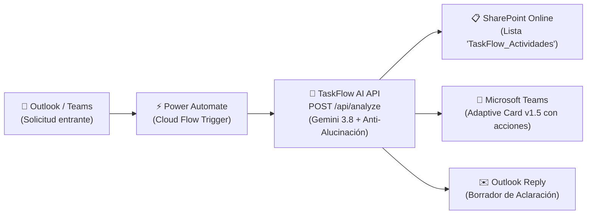

# TASKFLOW AI — MICROSOFT SHAREPOINT ONLINE & M365 INTEGRATION BLUEPRINT
<!-- Gobernado por SPEC-CRUD-SLACK-001 (ADR-CS-002) -->
<!-- Preparado especialmente para la sustentación con Luis Soto (Desarrollador Software Plataforma SharePoint) -->

Este paquete proporciona los artefactos técnicos necesarios para llevar **TaskFlow AI** desde el prototipo web hasta una integración nativa de grado empresarial dentro del ecosistema Microsoft 365 (SharePoint Online, Microsoft Teams, Outlook y Power Automate).

---

## 1. Contenido del Paquete

| Archivo | Propósito | Tecnología |
|---|---|---|
| `Provision-TaskFlowSharePointList.ps1` | Script automatizado para crear la lista personalizada `TaskFlow_Actividades`, con campos tipados, opciones y vistas. | PowerShell 7 + PnP.PowerShell |
| `power-automate-flow-blueprint.json` | Definición declarativa del flujo de Power Automate para conectar correos de Outlook y mensajes de Teams con la API. | Azure Logic Apps / Power Automate JSON Schema |
| `AdaptiveCard-Teams-v1.5.json` | Plantilla de Microsoft Teams Adaptive Card v1.5 para notificar las tareas procesadas en canales de Teams. | Adaptive Cards v1.5 JSON |

---

## 2. Arquitectura de Integración Microsoft 365



---

## 3. Instrucciones de Despliegue en SharePoint Online

### Paso 1: Ejecutar el script PnP.PowerShell
Abre PowerShell y ejecuta:

```powershell
# Instalar módulo PnP si no está instalado
Install-Module -Name PnP.PowerShell -Scope CurrentUser

# Ejecutar el aprovisionamiento
.\docs\sharepoint\Provision-TaskFlowSharePointList.ps1 -SiteUrl "https://tuempresa.sharepoint.com/sites/Operaciones"
```

El script creará automáticamente:
1. Lista `TaskFlow_Actividades` con control de versiones.
2. Campos:
   * `Title`: Nombre de la actividad identificada.
   * `Prioridad`: Elección (`Crítica (P0)`, `Alta (P1)`, `Media (P2)`, `Baja (P3)`).
   * `EstadoTarea`: Elección (`Pendiente`, `En progreso`, `Completada`).
   * `FechaLimite`: Fecha (DateOnly).
   * `EstadoFecha`: Elección (`Confirmada`, `Referencia Parcial`, `Información Faltante`).
   * `DetalleFaltante`: Múltiples líneas de texto (detalle de qué falta aclarar).
   * `Responsable`: Texto de una línea.
   * `CanalOrigen`: Elección (`Email`, `Slack`, `Teams`, `WhatsApp`).
   * `CitaTextualFuente`: Cita textual del mensaje original que sustenta la tarea (grounding).
3. Vista `Tareas con Info Faltante`: filtra automáticamente las tareas que requieren atención o confirmación de fecha.

### Paso 2: Importar el Flujo de Power Automate
1. Entra a [make.powerautomate.com](https://make.powerautomate.com).
2. Crea un nuevo flujo de nube automatizado basado en `docs/sharepoint/power-automate-flow-blueprint.json`.
3. Conecta el conector de **Office 365 Outlook** o **Microsoft Teams**.
4. Apunta la acción HTTP al endpoint en producción:
   * **URL:** `https://crud-slack.vercel.app/api/analyze`
   * **Método:** `POST`
   * **Cabecera:** `Content-Type: application/json`
5. ¡Listo! Cualquier correo recibido o mensaje marcado con el emoji ⚡ creará automáticamente las actividades en la lista de SharePoint.
